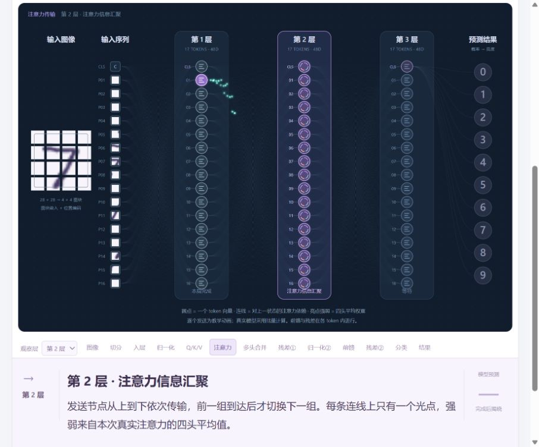

# 逐层 · ViT Digit Recognition

**`vit-digit-recognition`** 是一个轻量的 Transformer 手写数字识别与运算可视化实验台。

在画板写下单个数字，跟随固定的三层 token 节点和沿线光点，观察真实的小型 Vision Transformer 如何得到预测。网页使用原生 HTML、CSS、JavaScript，本地完成推理，无需后端、构建步骤或在线服务。



## 功能

- 鼠标或触控书写单个 0–9 数字，也可使用 30 个 MNIST 手写样例。
- 可视化输入切分、图块嵌入、归一化、Q/K/V、注意力、多头合并、前馈与残差。
- 三层共 **51 个 token 节点**始终固定显示；每层实际有 16 个图块 token 和 1 个 CLS。
- 连接对应真实注意力依赖，每条路径单次只有一个泛光光点，按发送端从上到下演示。
- 十个输出数字按本次真实预测概率逐渐点亮，最高概率最亮。
- 支持播放、暂停、前后单步、调速、选择过程与观察层。
- 每步可展开**目的、流程、输入、输出**详解；点击后暂停，切换步骤同步更新。


## 本地运行

下载或克隆仓库后，直接打开 `index.html`。Windows 也可以双击 `打开实验台.cmd`。网页运行不需要安装 Python、PyTorch 或 npm 包。

也可在项目根目录使用 Node.js 启动本机预览：

```sh
node tools/serve.js
```

打开 [本地实验台](http://127.0.0.1:7788/)。服务只监听本机。

写好数字后点击「开始识别与演示」。默认输入切分为 1 秒，其余步骤为 2 秒；可暂停阅读，或点击「查看过程详解」。每次只输入一个数字，尽量写大、完整。模型可能判断错误。

## 模型与可视化

| 配置 | 内容 |
| --- | --- |
| 模型 | Pre-LN Vision Transformer，3 层编码器 |
| 输入 | 28 × 28 单通道灰度图 |
| 图块 | 7 × 7 像素，共 16 块，另加 CLS |
| token | 每层 17 个，每个 48 维 |
| 注意力 | 每层 4 个头，每头 12 维，无因果遮罩 |
| 前馈网络 | 48 → 96 → 48，GELU（tanh 近似） |
| 输出 | 最终归一化 → CLS → 线性分类 → Softmax |
| 参数量 | 60,730；原始 float32 权重 242,920 字节 |
| 推理 | 原生 JavaScript CPU，无第三方运行库 |

节点表示 **token 向量**。跨列连线表示本层对输入状态的注意力依赖，光点强弱取本次推理的四头平均注意力权重。归一化、前馈和残差在各 token 内处理。按顺序发送的光点是教学演示，真实计算采用批量处理。

概率和注意力权重均来自真实模型；节点位置、内部图形、光点速度和亮度映射用于帮助理解。不同路径的光点进度略有错开，以避免视觉上排成光串。

训练采用 MNIST：55,000 张训练、5,000 张验证、10,000 张独立测试；随机种子 42，训练 16 轮。最佳验证准确率 **98.70%**，独立测试准确率 **99.01%**。这些指标不代表鼠标手写准确率。详情见 [模型元数据](model/manifest.json) 和 [训练历史](docs/training-history.json)。

## 验证

仅需要 Node.js，在项目根目录执行：

```sh
node tools/check-local.js
node tools/verify.js
node tools/verify-flow.js
```

检查包含资源完整性、语法、12 张图的 JS / PyTorch 数值对照、30 个样例、真实注意力方向、单光点时序和 29 步详解覆盖。对照夹具已包含在仓库中，无需下载训练集。报告自动写入被 Git 忽略的 `work/`。

详细范围见 [验证说明](docs/VALIDATION.md)。

## 重新训练（可选）

仅重新训练需要 Python、NumPy 和 PyTorch。`requirements-dev.txt` 记录本项目训练环境中的依赖版本；网页运行不使用这些依赖。

```sh
python -m pip install -r requirements-dev.txt
python tools/train.py --epochs 16
node tools/verify.js
```

首次训练会从 CVDF 的 MNIST 镜像下载数据到 `work/data/`。训练完成后导出模型、30 个样例和压缩的 PyTorch 对照夹具。检查点与完整数据集保留在本地，不提交到 Git。

## 项目结构

```text
index.html                 页面入口
style.css                  页面与详解样式
app.js                     画板、预处理、动画与播放控制
flow.js                    模型图、时序、权重映射与逐步详解
engine.js                  原生 JavaScript ViT 推理
model/                     已训练模型、元数据与内置样例
tools/                     预览、训练、数值与结构检查
tests/fixtures/            可直接使用的 PyTorch 对照数据
docs/                      预览图、训练历史与说明
work/                      本地生成数据与临时文件（Git 忽略）
```

如果只分发运行版，保留 `index.html`、`style.css`、`app.js`、`flow.js`、`engine.js`、`model/model-data.js`、`README.md` 即可；Windows 启动脚本可按需一起保留。

## GitHub 上传

仓库名使用 `vit-digit-recognition`。本地仓库连接与首次推送方法见 [上传说明](docs/GITHUB.md)。

## 参考与数据来源

- [Vision Transformer 论文](https://arxiv.org/abs/2010.11929)
- [MNIST 数据与 CVDF 镜像](https://github.com/cvdfoundation/mnist)：训练、测试、内置样例及对照图像的数据来源。
- [PyTorch GELU 文档](https://docs.pytorch.org/docs/stable/generated/torch.nn.GELU.html)

本项目训练并使用面向数字识别教学的小型 ViT，模型结构与参数规模见上表。
